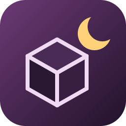
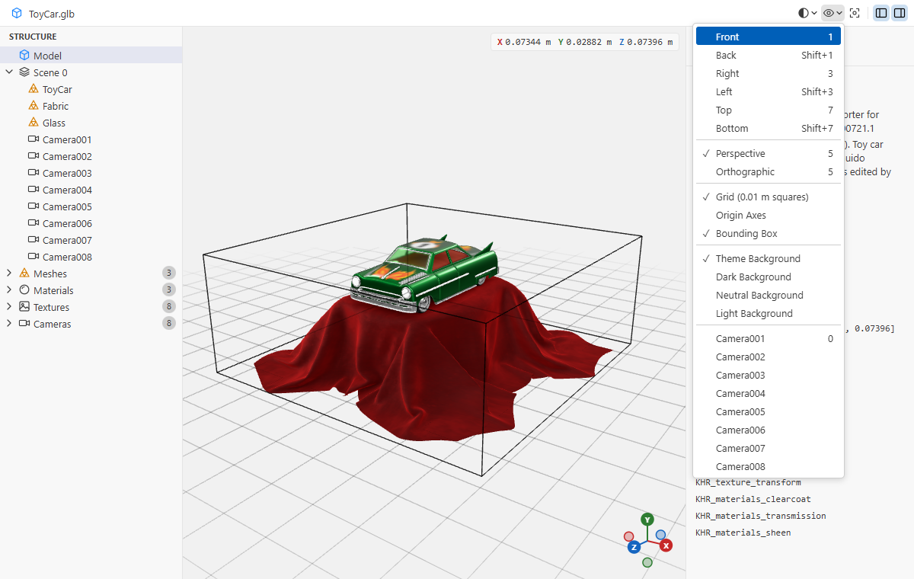
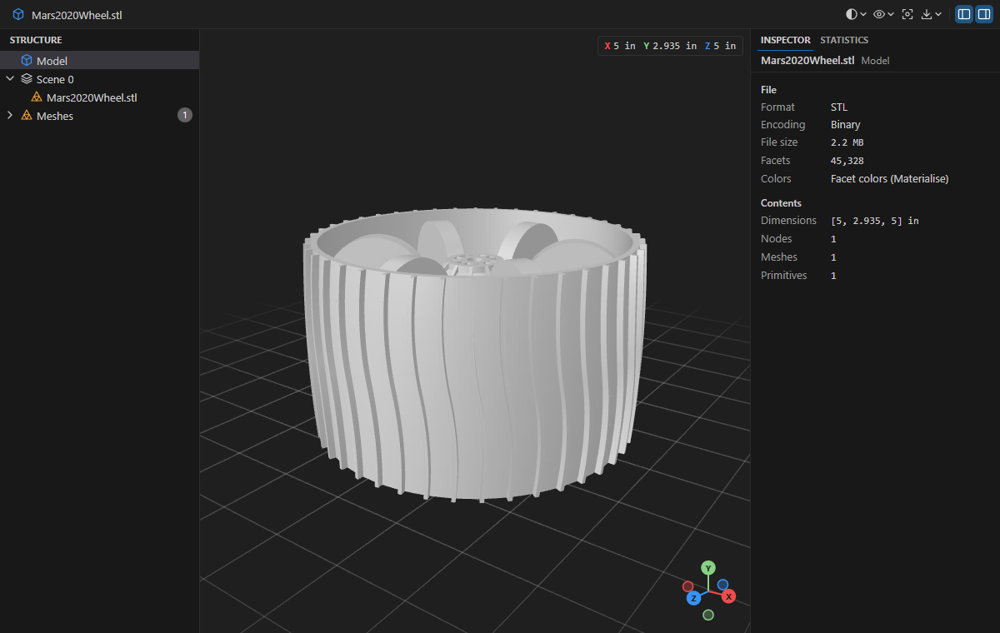
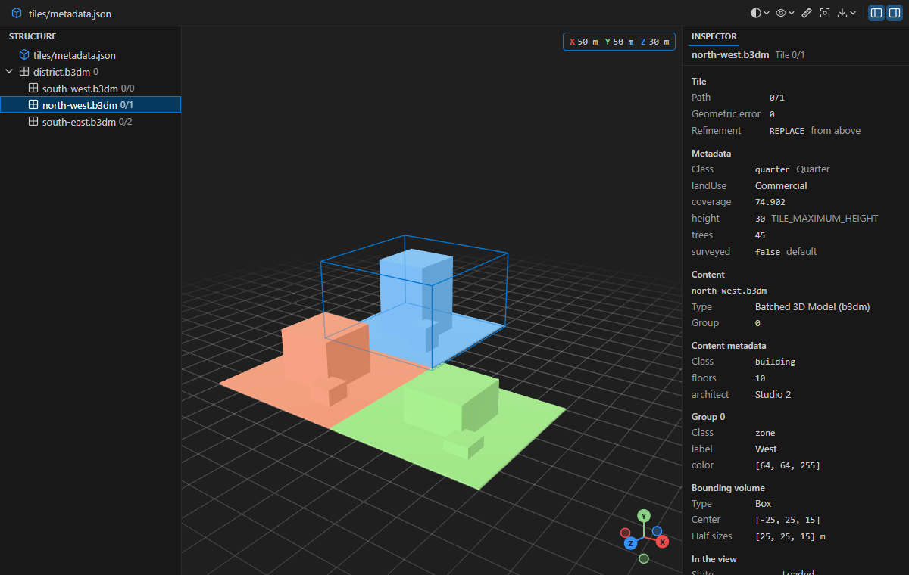
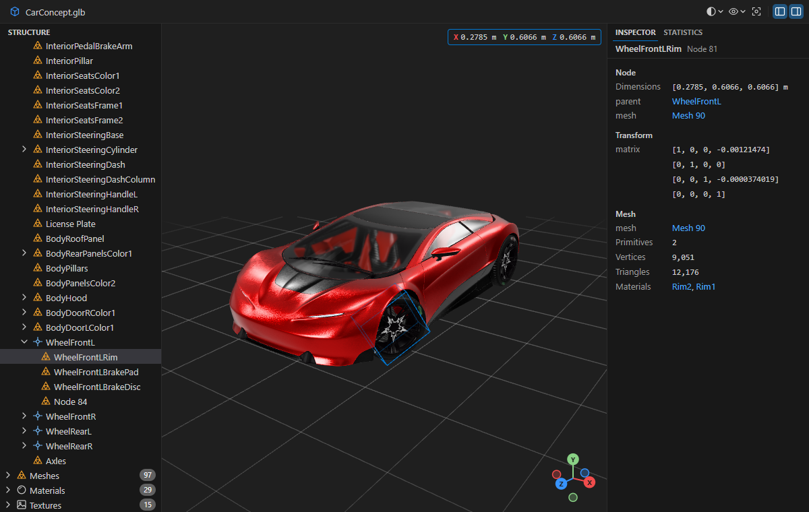
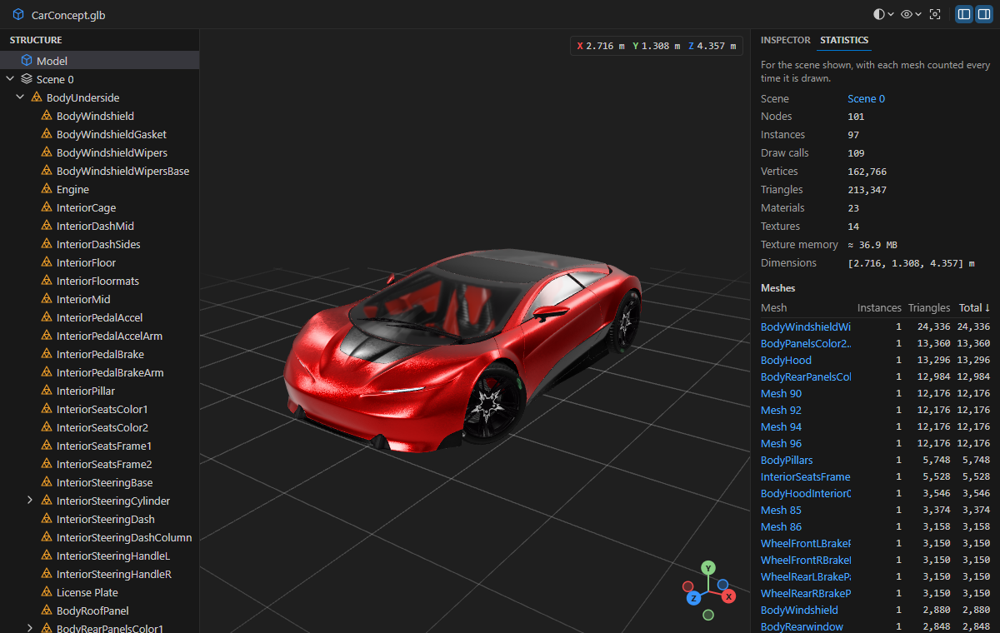
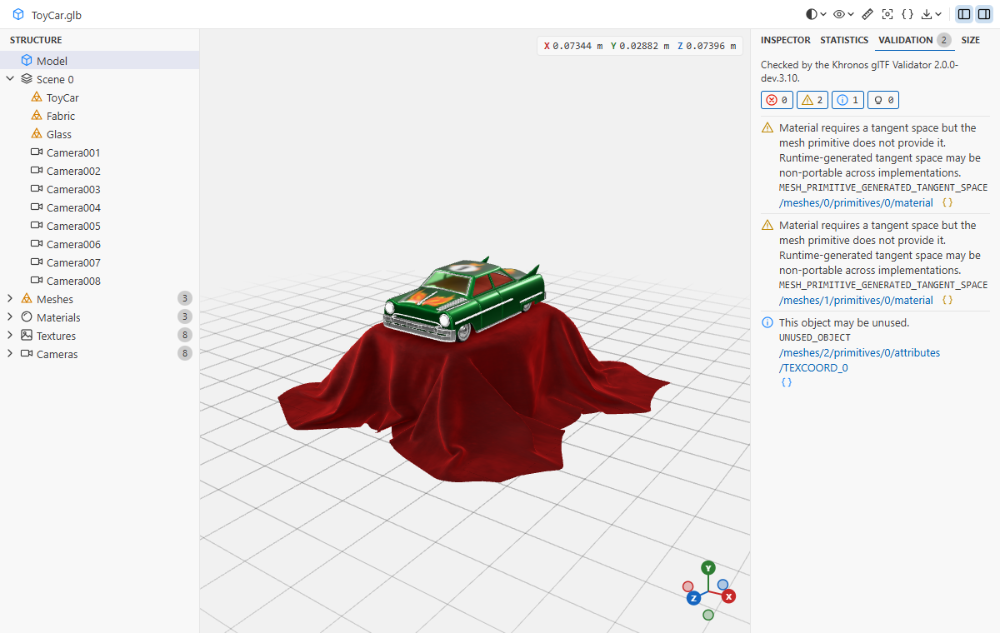
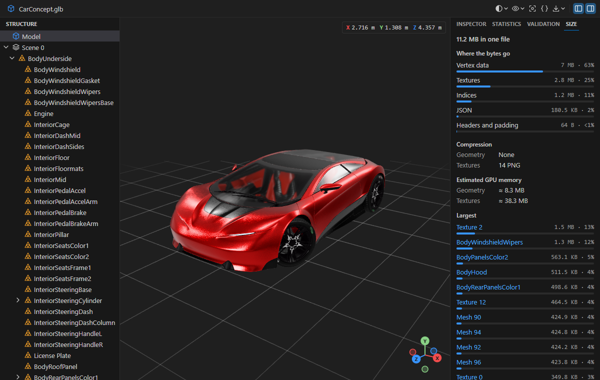
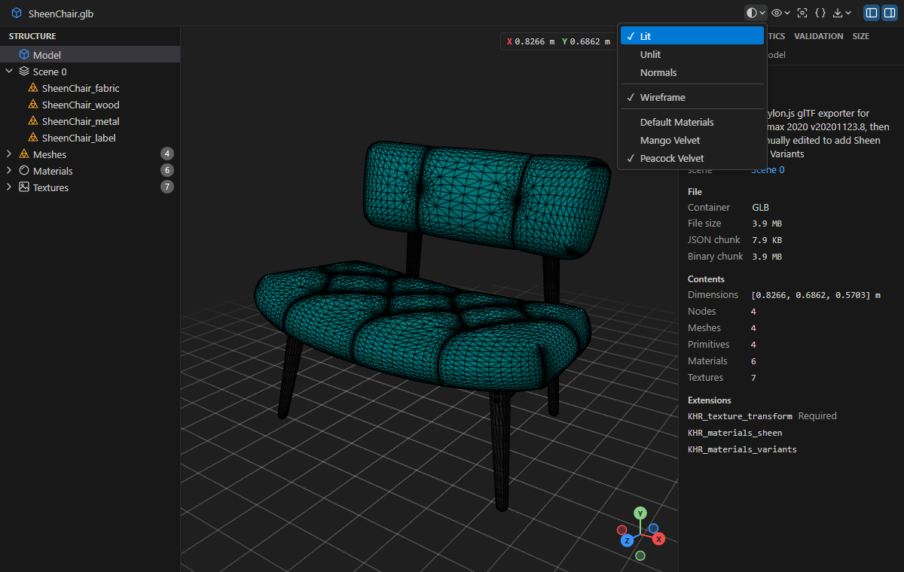
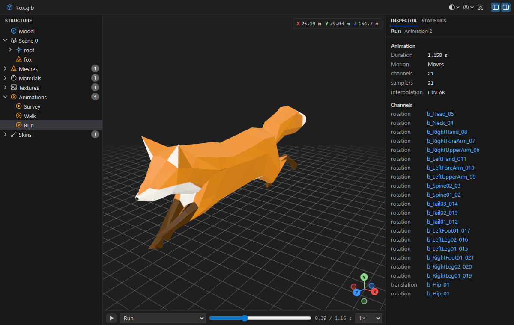

# Nightmesh

[](https://marketplace.visualstudio.com/items?itemName=MBKDevStudio.nightmesh)
[](https://marketplace.visualstudio.com/items?itemName=MBKDevStudio.nightmesh)
[](https://open-vsx.org/extension/MBKDevStudio/nightmesh)
[](https://open-vsx.org/extension/MBKDevStudio/nightmesh)
[](https://github.com/mbKalkan/nightmesh/actions/workflows/ci.yml)
[](LICENSE)

**View, inspect, compare and measure glTF, GLB, OBJ, STL and PLY 3D models and 3D Tiles in
VS Code, in your dark theme.**

Nightmesh is a fast, offline, view-only viewer for 3D models: glTF (`.glb`, and `.gltf` with
its `.bin` files and textures), OBJ with its materials and textures, STL and PLY, and 3D Tiles
tilesets with their tiles (`.b3dm`, `.i3dm`, `.pnts`, `.cmpt`). It shows the
model in a 3D view that follows your color theme, and next to it what the file holds: its node
tree, meshes, materials, textures and animations, how many triangles it draws and how big it
is. A glTF's structure is there as soon as the file opens, before the geometry has loaded, even
for files of hundreds of megabytes. It compares two versions of a model side by side, as Source
Control shows them, and measures distances on it.


## Why Nightmesh

- **Structure first.** The node tree, the inspector and the statistics show right away, read
  from the file's JSON. You can find your way around a large model while its geometry is still
  loading, and also in a model that can't be drawn.
- **One viewer for the files you have.** glTF from game engines and the web, STL from CAD and
  3D printing, OBJ and PLY from modelling tools, scanners and photogrammetry, 3D Tiles from
  geospatial pipelines, with the same tools for all of them.
- **Inspect, not just look.** Click a part to see which node it is, where it sits in the
  hierarchy, its transform, mesh, materials and size. Follow the links from a mesh to its
  materials and textures, and count what the scene puts on the GPU.
- **Point an AI assistant at a part.** Right-click a part and choose **Copy Reference** to get
  `models/robot.glb, node "Arm" (nodes[12]), under Root › Body` on the clipboard, ready to paste
  into a chat with Claude Code or any assistant that works in your workspace.
- **Offline and private.** The Draco, meshopt and KTX2 decoders and the lighting ship with the
  extension. No network access, no CDN, no telemetry.
- **View-only.** Your model files are never written to.

## Features

### The 3D view

- Orbit, pan and zoom with the mouse. The model is framed when it opens and keeps your view
  when the file changes on disk.
- Look from the front, right or top with the **View** menu or the number keys 1, 3 and 7, as in
  Blender, and from the other side with Shift. 5 switches between perspective and orthographic.
  An axes gizmo shows which way X, Y and Z point; click an axis to look along it.
- Look through the cameras saved in the model, with their field of view.
- A ground grid in squares of a power of ten metres (or of the file's unit), sized to the
  model, the world's axes and the model's bounding box. The background can follow your theme or
  be dark, neutral or light.
- The size of the model, or of what is selected, in the corner of the view.
- **Measure** the distance between two points on the model: click them with the ruler on (the
  toolbar or <kbd>M</kbd>), and the length shows over the line, with how far apart they are
  along X, Y and Z in the corner. Measure as many as you need; <kbd>Backspace</kbd> removes the
  last. Clicks near a corner snap to it, and clicks near an edge of the shape snap onto the edge,
  so edges measure exactly. In the file's units for OBJ, STL and PLY.
- Models are lit by a built-in environment, so they look right without any setup.
- Draco and meshopt compressed meshes, quantized models and KTX2 (Basis Universal) textures open
  too. Their decoders load only when a model needs them.



### OBJ, STL and PLY

- **OBJ** with its MTL materials and textures, objects and groups, polygons, lines and points;
  surfaces without normals are smooth where the file puts them in a smoothing group and sharp
  between groups, as Blender and 3ds Max draw them. **STL**, binary and ASCII, with Materialise colors. **PLY**, ASCII and binary, meshes and
  point clouds, with vertex colors and textures. They are read in a thread of their own, so VS
  Code stays responsive with files of hundreds of megabytes.
- The structure, inspector, statistics, selection, shading, Copy Reference and export work as
  they do for glTF. The inspector also shows what the file says about itself: an STL's header
  and solids, a PLY's elements, properties and comments, an OBJ's statements and each
  material's MTL statements.
- A **mesh check**, as for 3D printing: the surface area, whether the model is watertight and
  the volume it holds, and what keeps it from being so: open edges, edges of more than two
  faces, faces wound the wrong way. It counts the separate shells too.
- These formats seldom say what their units are or which way is up. STL opens in millimetres
  with Z up, as CAD writes it; OBJ and PLY in metres with Y up, or Z up when their coordinates
  are georeferenced, and an OBJ in the unit its comments name, as Maya writes. The **View** menu
  sets the units and the up axis, and the next file of the same format opens that way. Sizes and
  the grid follow the file's units.
- What can't be shown is listed over the model: a missing material library or texture, faces
  naming vertices the file lacks, a file cut short.



### 3D Tiles

- **Tilesets** open from a `tileset.json`: right-click it and choose **Open With… › Nightmesh
  3D Tiles**. The tiles the camera needs load as it moves, the nearer ones in more detail, read
  from disk by the extension, never from the network. A tileset placed on the globe is shown at
  the origin, upright, seen from the south.
- 3D Tiles 1.0 and 1.1: external tilesets, implicit tiling (quadtrees and octrees, binary and
  JSON subtrees), tiles with several contents, and Batched (b3dm), Instanced (i3dm), Point Cloud
  (pnts), Composite (cmpt) and glTF tiles, with Draco, meshopt and KTX2 compression.
- The **tile tree** lists the tiles as soon as the tileset opens, and those of external tilesets
  and implicit tiling as they are read. The inspector gives a tile's geometric error,
  refinement, contents, bounding volume and implicit tiling, and whether the view has it loaded
  and drawn; the tileset's counts what is loaded, drawn and on its way, and the memory it takes.
  The selected tile's volume is boxed in the view, and a click on the model selects its tile.
- **Metadata**: click a building or a point and the inspector shows that feature's properties,
  from the tile's batch table or the glTF's `EXT_mesh_features` and `EXT_structural_metadata`.
  The tileset's, its tiles', contents' and groups' metadata show with their class, read as the
  schema says, implicit tiles' from their subtrees too.
- A `.b3dm`, `.i3dm`, `.pnts` or `.cmpt` file opens on its own, with the glTF tools for the model
  it holds and what the tile says around it: its header, feature and batch tables.



### Structure and inspector

- The **Structure** panel lists the scenes and node hierarchy, then the meshes, materials,
  textures, animations, skins, cameras and lights. It stays fast with tens of thousands of nodes.
- The **Inspector** shows what is selected: a node's transform and mesh, a mesh's primitives,
  vertices and attributes, material values with color swatches, texture size, mip levels and
  GPU memory with a preview of the image, animation channels and more, with links between them.
- **Show glTF JSON** opens the model's JSON beside the viewer, a GLB's too, at what is
  selected. It follows the selection both ways: move through the JSON and the viewer selects
  what the cursor is in.
- What is selected is outlined in the 3D view: a node, every node that uses a mesh, every part
  drawn with a material. Click the model to select what is under the pointer, and the tree opens
  to it. Frame Selection (F, or a double-click) brings it into view.



### Statistics

- The **Statistics** tab counts the scene that is shown, before its geometry loads: nodes, mesh
  instances, draw calls, vertices, triangles, materials, textures, estimated texture memory and
  the scene's dimensions.
- A table of meshes, sorted by the triangles they put on screen, finds the heavy ones. Click a
  name to select the mesh and see where it is drawn.
- For a model with animations: how many clips, the longest, channels, keyframes and the nodes
  they move.



### Validation

- The **Validation** tab runs the official Khronos glTF Validator on the model, in the
  background once it has loaded. Its `.bin` files and textures are checked too.
- Errors, warnings, infos and hints are counted and can be hidden or shown; the tab counts the
  errors and warnings. Click an issue's JSON pointer to select what it is about, or show it in
  the glTF JSON.



### Size and optimization

- The **Size** tab breaks the file down into JSON, vertex data, indices, morph targets,
  animations, skins and textures, with the files a `.gltf` uses, and finds data nothing uses.
- How the geometry (Draco, meshopt, quantization) and the textures (KTX2, WebP, PNG, JPEG) are
  compressed, and the GPU memory they are estimated to take.
- The largest meshes, textures and animations, and each image's format, size and bytes, marked
  when it is larger than 4096 pixels or not a power of two.
- Suggestions for a lighter model, with the [glTF Transform](https://gltf-transform.dev) command
  that writes an improved copy. Nightmesh never changes the file itself.



### Shading and materials

- The **Shading** menu draws the model lit as its materials say, unlit in their base colors and
  textures, or colored by the direction its surfaces face, to check normals. A wireframe can be
  drawn over any of them.
- Models with material variants (`KHR_materials_variants`) switch between them from the same
  menu.
- Physically based materials with their Khronos extensions: clearcoat, sheen, transmission,
  volume, iridescence, anisotropy, dispersion, specular, IOR, emissive strength, bump and unlit.
  Textures can be PNG, JPEG, WebP, AVIF or KTX2.



### Animations

- Play a model's animations from a bar below the view: pick a clip, play and pause (Space), scrub
  the time line and change the speed.
- A clip whose keyframes move nothing, as some exporters write them, is marked as such, so a
  model that doesn't move isn't mistaken for a viewer problem.



### Everywhere

- **Export** the view as a PNG, or a report on the model (details, statistics, size, suggestions
  and validation) as Markdown or JSON, to a new file you pick.
- **Copy Reference** in the right-click menu, for a part in the view, a row in the structure or a
  link in the inspector. **Copy Reference with Details** adds what the inspector says about it.
  Both are in the Command Palette too, where they refer to the selection.
- **Compare two versions** side by side (Source Control, the Timeline, Compare Selected): both
  views move together, a **Changes** tab lists what was added, removed or changed (nodes,
  meshes, materials, textures, animations, and the totals), the structure marks it as Source
  Control marks files, boxes in the same colors frame it in the view, and selecting on one side
  selects the same on the other.
- Earlier versions from Git (the Timeline, Source Control, a comparison) open as they were
  committed, including models kept in Git LFS whose content is on this machine.
- Live reload that keeps your view when the file is saved.
- Files that can't be shown say why. When only part of a model can be loaded, such as a missing
  `.bin` or texture, the rest is drawn and a note lists what was left out.
- A model larger than 1 GB waits for **Draw Model** before it's loaded into the view; its
  structure and statistics show right away.
- Dark, light and high contrast themes.
- Keyboard and screen reader support.
- English and Turkish.

## Getting started

1. Install **Nightmesh** from the
   [Visual Studio Marketplace](https://marketplace.visualstudio.com/items?itemName=MBKDevStudio.nightmesh)
   or, in VSCodium and other editors that use it,
   [Open VSX](https://open-vsx.org/extension/MBKDevStudio/nightmesh). Or search for "Nightmesh"
   in the Extensions view.
2. Open a `.glb`, `.gltf`, `.obj`, `.stl` or `.ply` file. Nightmesh is the default viewer for
   these files, and for 3D Tiles' `.b3dm`, `.i3dm`, `.pnts` and `.cmpt`. A tileset is a JSON
   file, which VS Code opens as text: right-click it and choose **Open With… › Nightmesh 3D
   Tiles**.

If another extension also opens these files, right-click the file and choose
**Open With… › Nightmesh**, then **Configure default editor**. Or add this to your settings:

```json
"workbench.editorAssociations": {
  "*.glb": "nightmesh.viewer",
  "*.gltf": "nightmesh.viewer",
  "*.obj": "nightmesh.viewer",
  "*.stl": "nightmesh.viewer",
  "*.ply": "nightmesh.viewer"
}
```

An `.obj` that is a compiler's object file, not a model, is said to be one: open it with
**Open With… › Text Editor** or another extension.

## Mouse and keyboard

| Action                                      | Mouse or key                                              |
| ------------------------------------------- | --------------------------------------------------------- |
| Orbit                                       | Drag, or the arrow keys in the view                       |
| Pan                                         | Right-drag, or <kbd>Shift</kbd>+drag                      |
| Zoom                                        | Mouse wheel, or <kbd>+</kbd> / <kbd>-</kbd>               |
| Select what is under the pointer            | Click                                                     |
| Frame the selection                         | <kbd>F</kbd>, or double-click                             |
| Let go of the selection                     | <kbd>Esc</kbd>, or click empty space                      |
| Look from the front, right or top           | <kbd>1</kbd>, <kbd>3</kbd>, <kbd>7</kbd>                  |
| Look from the back, left or bottom          | <kbd>Shift</kbd>+<kbd>1</kbd>, <kbd>3</kbd>, <kbd>7</kbd> |
| Look from the other side                    | <kbd>9</kbd>                                              |
| Switch between perspective and orthographic | <kbd>5</kbd>                                              |
| Look through the next camera in the model   | <kbd>0</kbd>                                              |
| Play or pause the animation                 | <kbd>Space</kbd>                                          |
| Measure between two clicked points          | <kbd>M</kbd>, then click twice; <kbd>Esc</kbd> to stop    |
| Remove the last measurement                 | <kbd>Backspace</kbd>                                      |

The number keys work on the main keyboard and the number pad. Nightmesh doesn't use
<kbd>Ctrl</kbd> shortcuts in the view, so VS Code's own stay as they are.

## Limitations

- Nightmesh opens glTF 2.0, OBJ, STL, PLY and 3D Tiles. Other formats, such as FBX, USD and
  STEP, don't open.
- In 3D Tiles, vector, voxel and Gaussian splat contents, and terrain, aren't drawn; metadata
  semantics are shown but don't change how tiles are drawn. Tiles are read from the tileset's
  workspace folder: never from the network.
- The Validation and Size tabs and Show glTF JSON are for glTF files.
- OBJ's free-form curves and surfaces aren't drawn, and textures in formats browsers can't show,
  such as TGA, are left out; Nightmesh says so.
- The glTF Validator doesn't know some extensions, such as `KHR_texture_basisu` and
  `EXT_meshopt_compression`: it says so, and may warn about what they change.
- Models that require `KHR_materials_pbrSpecularGlossiness` can't be drawn yet; Nightmesh says
  so and still shows their structure. Animations of material and node properties
  (`KHR_animation_pointer`) don't play.
- One animation clip plays at a time.
- A `.gltf`'s `.bin` files and textures are read only from the model's folder and workspace:
  never from the network or an absolute path.
- Nightmesh needs desktop VS Code: it isn't available in VS Code for the Web yet.

## Contributing

Bug reports and ideas are welcome in [issues](https://github.com/mbKalkan/nightmesh/issues).
See [CONTRIBUTING.md](CONTRIBUTING.md) to build and test the extension.

## License

[MIT](LICENSE). Third-party components and their licenses are listed in
[THIRD_PARTY_NOTICES.md](THIRD_PARTY_NOTICES.md), along with the credits for the models in the
screenshots above, from the [Khronos glTF Sample Assets](https://github.com/KhronosGroup/glTF-Sample-Assets)
and [NASA 3D Resources](https://github.com/nasa/NASA-3D-Resources).
